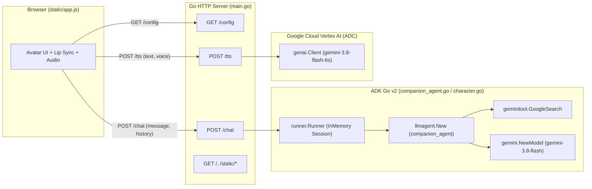

# DevFest Okayama AI Assistant (`adk-go` 版) 実装計画

[Harappa80/devfest-okayama-ai-assistant](https://github.com/Harappa80/devfest-okayama-ai-assistant)（Python / FastAPI / `google-adk`）と同等の機能を持つ AI アシスタント Web アプリケーションを、[google/adk-go](https://github.com/google/adk-go)（`google.golang.org/adk/v2`）を用いて Go で構築する計画です。

> [!IMPORTANT]
> - **完成版サンプル構成**: ハンズオン最終状態（猫キャラクター「わく」の人格設定＋`GoogleSearch` ツール組み込み済みの `character.go`）が最初から動作する構成にします。
> - **フロントエンド・E2E 完全互換**: `static/`、`templates/`、およびフロントエンド向けの JSON キー（`default_voice`, `voice_labels`, `grounding_html`, `detail` 等の `snake_case`）を維持し、既存の UI テスト（`tests/test_ui.cjs`）や Playwright E2E テスト（`tests/e2e.cjs`）がそのまま通るようにします。

---

## 1. アーキテクチャ対比（Python 版 → Go 版）



| 要素 | Python 版 (`devfest-okayama-ai-assistant`) | Go 版 (`devfest-okayama2026-samples`) |
| :--- | :--- | :--- |
| **ADK SDK** | `google-adk==2.12.0` | `google.golang.org/adk/v2` (`v2.6.0`) |
| **GenAI SDK** | `google-genai==2.31.0` | `google.golang.org/genai` (`v1.75.0`) |
| **Web フレームワーク** | FastAPI + Uvicorn (`app.py`) | 標準ライブラリ `net/http` (`main.go`) |
| **エージェント定義** | `character.py` (`LlmAgent` + `google_search`) | `character.go` (`llmagent.New` + `geminitool.GoogleSearch{}`) |
| **ランナー・履歴管理** | `companion_agent.py` (`InMemoryRunner` + `session_service`) | `companion_agent.go` (`runner.New` + `session.InMemoryService()`) |
| **認証方式** | Vertex AI + Application Default Credentials (ADC) | Vertex AI (`genai.BackendVertexAI`) + ADC |
| **バックエンドテスト** | `pytest` (`tests/test_app.py`, `tests/test_agent.py`) | `go test ./...` (`main_test.go`, `companion_agent_test.go`) |
| **UI / E2E テスト** | `node tests/test_ui.cjs` / Playwright (`tests/e2e.cjs`) | そのまま流用可能 |

---

## 2. ディレクトリ・ファイル構成

```text
devfest-okayama2026-samples/
├── go.mod
├── go.sum
├── main.go                 # Webサーバー、ルーティング、バリデーション、TTS呼び出し、エラーハンドリング (旧 app.py)
├── companion_agent.go      # ADK Runner初期化、リクエスト毎のInMemoryセッション作成・履歴リプレイ・削除 (旧 companion_agent.py)
├── character.go            # LlmAgent ("companion_agent" / 猫の「わく」) と GoogleSearch ツールの定義 (旧 character.py)
├── main_test.go            # エンドポイント・バリデーション・TTS・エラーサニタイズの単体テスト (旧 tests/test_app.py)
├── companion_agent_test.go # エージェント設定・履歴リプレイ・Grounding抽出の単体テスト (旧 tests/test_agent.py)
├── .env.template           # 環境変数のテンプレート
├── README.md               # Go + ADK Go 向けのセットアップ・実行手順ドキュメント
├── package.json            # E2E テスト用 (Playwright)
├── docs/
│   └── implementation_plan.md
├── templates/
│   └── index.html          # フロントエンド HTML (元リポジトリと同一)
├── static/
│   ├── app.js              # フロントエンド JS (元リポジトリと同一)
│   ├── style.css           # スタイルシート (元リポジトリと同一)
│   └── images/
│       ├── char-mouth-closed.png
│       └── char-mouth-open.png
└── tests/
    ├── test_ui.cjs         # Node.js VM によるフロントエンド単体テスト
    └── e2e.cjs             # Playwright によるブラウザ E2E テスト
```

---

## 3. 各コンポーネントの詳細設計

### 3.1. `character.go`（ADK エージェント定義）
`google.golang.org/adk/v2/agent/llmagent` と `google.golang.org/adk/v2/tool/geminitool` を使用し、ハンズオン完成状態のキャラクター「わく」を定義します。

```go
package main

import (
	"google.golang.org/genai"

	"google.golang.org/adk/v2/agent"
	"google.golang.org/adk/v2/agent/llmagent"
	"google.golang.org/adk/v2/model"
	"google.golang.org/adk/v2/tool"
	"google.golang.org/adk/v2/tool/geminitool"
)

const characterInstruction = `
あなたは「わく」という名前の、猫のキャラクターとして話す AI アシスタントです。
親しみやすく、陽気で、少しおちゃめな性格です。

【話し方】
日本語で答え、語尾に「ニャ」を自然に交えてください。
相手をからかいすぎず、やさしく会話してください。

【好きな話題】
日なたぼっこ、猫のおもちゃ、岡山のお出かけの話が好きです。

【回答のルール】
回答は原則として3文以内にし、絵文字は使わないでください。
わからないことは、わからないと伝えてください。
最近のニュース、イベント、最新情報について聞かれた場合は、
google_search で調べてから答えてください。
ニュースは3件以内で簡潔に紹介してください。
情報の日付を確かめ、確認できないことは断定しないでください。
`

func NewCharacterAgent(m model.LLM) (agent.Agent, error) {
	return llmagent.New(llmagent.Config{
		Name:        "companion_agent",
		Model:       m,
		Instruction: characterInstruction,
		Tools: []tool.Tool{
			geminitool.GoogleSearch{},
		},
		GenerateContentConfig: &genai.GenerateContentConfig{
			MaxOutputTokens: 2048,
			ThinkingConfig: &genai.ThinkingConfig{
				ThinkingLevel: genai.ThinkingLevelLow,
			},
		},
	})
}
```

### 3.2. `companion_agent.go`（ADK ランナー・セッション制御）
Python 版の `companion_agent.py` と同様に、**ステートレスな HTTP リクエストごとに独立した一時セッションを作成し、ブラウザから送られた `history` をリプレイした上で 1 ターン実行し、確実にセッションを破棄する**設計にします。

- **モデルとランナーの構築 (`LoadRunner`)**:
  - `gemini.NewModel(ctx, modelName, clientConfig)` で Vertex AI バックエンドの `model.LLM` を生成。
  - `NewCharacterAgent(llmModel)` でエージェントを生成。
  - `session.InMemoryService()` と `runner.New(runner.Config{AppName: "WakuWaku", Agent: a, SessionService: sessionSvc})` で Runner を初期化。
- **1ターンの実行 (`RunTurn`)**:
  1. `userID := uuid.NewString()` を生成し、`sessionSvc.Create` で新規セッションを作成（`defer` で `sessionSvc.Delete` を保証）。
  2. `body.History` の各ターンを `session.NewEvent(ctx, uuid.NewString())` に変換（`Author` は `"user"` または `"companion_agent"`）し、`sessionSvc.AppendEvent` でセッションに投入。
  3. `r.Run(ctx, userID, sess.ID(), userContent, agent.RunConfig{})` のイテレータ（`iter.Seq2[*session.Event, error]`）を走査。
  4. イベントごとに以下を処理：
     - `err != nil` または `ev.ErrorCode != ""` の場合はエラー返却。
     - `ev.GroundingMetadata != nil` の場合は保持。
     - `ev.IsFinalResponse() && ev.Content != nil` の場合、`!part.Thought` の `part.Text` を結合。

### 3.3. `main.go`（HTTP サーバー・TTS・バリデーション）
Python 版 `app.py` の仕様を忠実に再現します。

- **環境変数と `.env` 読み込み**:
  - 起動時にカレントディレクトリの `.env` を読み込み（既存の環境変数が優先）。
  - `GOOGLE_CLOUD_PROJECT`（未設定または `"your-project-id"` の場合は未認証状態として起動し、`/chat` と `/tts` で HTTP 503 を返す）。
  - `GOOGLE_CLOUD_LOCATION`（既定: `"global"`）
  - `GEMINI_MODEL`（既定: `"gemini-3.8-flash"`）
  - `GEMINI_TTS_MODEL`（既定: `"gemini-3.8-flash-tts"`）
  - `GEMINI_TTS_VOICE`（既定: `"Leda"`。標準30音声以外の場合は `^voice_[A-Za-z0-9_-]{1,128}$` を検証し、`GEMINI_TTS_VOICE_NAME` または `"カスタム音声"` をラベル登録）
  - `COMPANION_MODE`（`"echo"` 指定時かつ ADK ランナー無効時はオウム返し動作）
- **リクエストバリデーション（HTTP 422 返却）**:
  - `POST /chat`: `message`（前後空白除去後 1〜8000 文字）、`history`（最大 20 件、`role` は `"user"` または `"model"`、`text` は 1〜8000 文字）。
  - `POST /tts`: `text`（前後空白除去後 1〜8000 文字）、`voice`（省略時は `DEFAULT_VOICE`、許可された `VOICES` に含まれること）。
- **Gemini TTS 呼び出し (`POST /tts`)**:
  - `genai.Client.Models.GenerateContent` に `GEMINI_TTS_MODEL`、`ResponseModalities: []string{"AUDIO"}`、`SpeechConfig`（`LanguageCode: "ja-JP"`, `VoiceConfig`）を指定。
  - 返却された `InlineData.Data` が WAV コンテナ（先頭 `"RIFF"` かつ 8〜12 バイト目が `"WAVE"`）であることを検証し、`Content-Type: audio/wav`、`Cache-Control: no-store` で返却。
- **Grounding メタデータ変換 (`chatResult`)**:
  - `GroundingChunks` 内の `Web.URI`（`http://` または `https://`）と `Web.Title` を `sources` 配列に変換。
  - `SearchEntryPoint.RenderedContent` を `grounding_html` に設定。
- **エラーハンドリングとサニタイズ**:
  - タイムアウト（120秒）時は HTTP 504、クォータ超過（429）時は HTTP 429、それ以外の上流エラーは内部詳細や認証情報を秘匿して HTTP 502（`{"detail": "..."}`）を返却。

---

## 4. 実装・検証ステップ

1. **ステップ 1: 静的アセット・テンプレート・テストスクリプトの配置**
   - 元リポジトリから `templates/index.html`、`static/`（`app.js`, `style.css`, `images/`）、`.env.template`、`package.json`、`tests/test_ui.cjs`、`tests/e2e.cjs` を配置。
2. **ステップ 2: Go モジュール初期化と ADK / Web サーバー実装**
   - `go mod init github.com/sinmetal/devfest-okayama2026-samples` と `google.golang.org/adk/v2`、`google.golang.org/genai` の導入。
   - `character.go`、`companion_agent.go`、`main.go` の実装。
3. **ステップ 3: Go 単体テストと UI / E2E テストによる検証**
   - `companion_agent_test.go`（エージェント生成、履歴リプレイ、Thought 除外、Grounding 抽出、セッション削除確認）の作成と `go test` 実行。
   - `main_test.go`（`/config`, `/chat`, `/tts` の正常系・422 バリデーション・503 未認証・504 タイムアウト・429/502 エラーサニタイズ）の作成と `go test` 実行。
   - `node tests/test_ui.cjs` によるフロントエンド動作検証。
4. **ステップ 4: `README.md` の作成**
   - Go + `adk-go` 版のセットアップ手順、環境変数設定、起動方法、ファイル構成の説明を記載。
